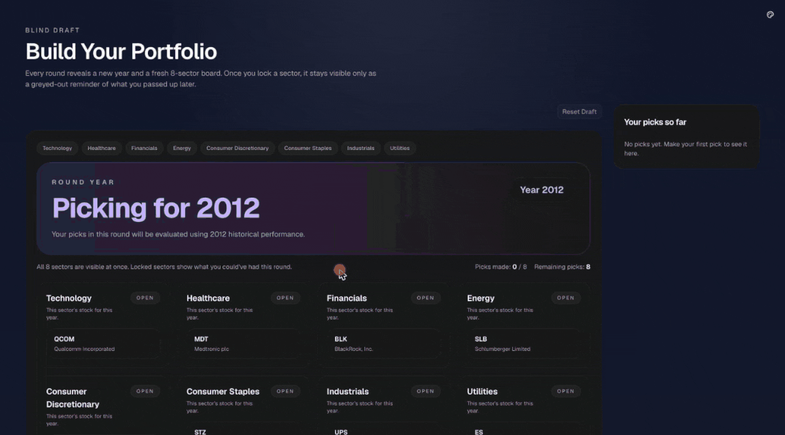
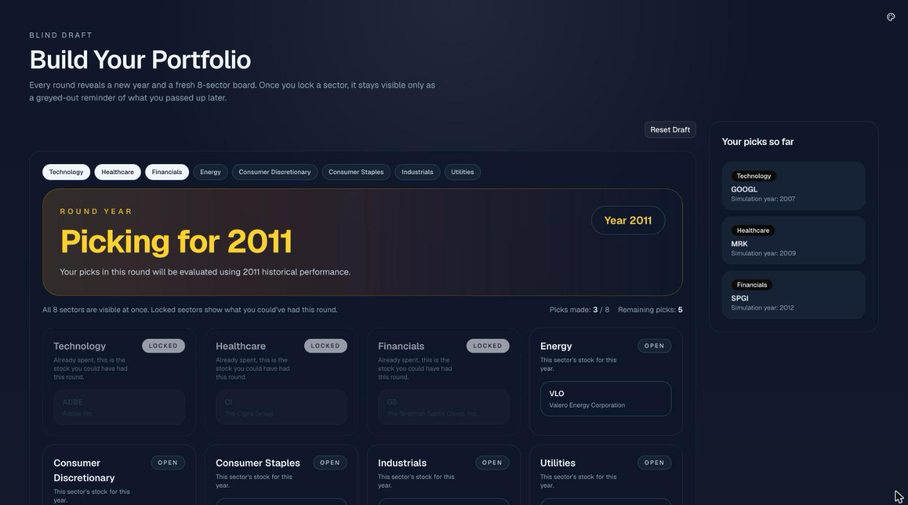
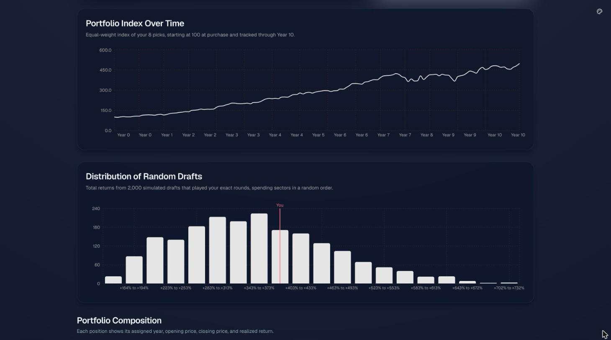
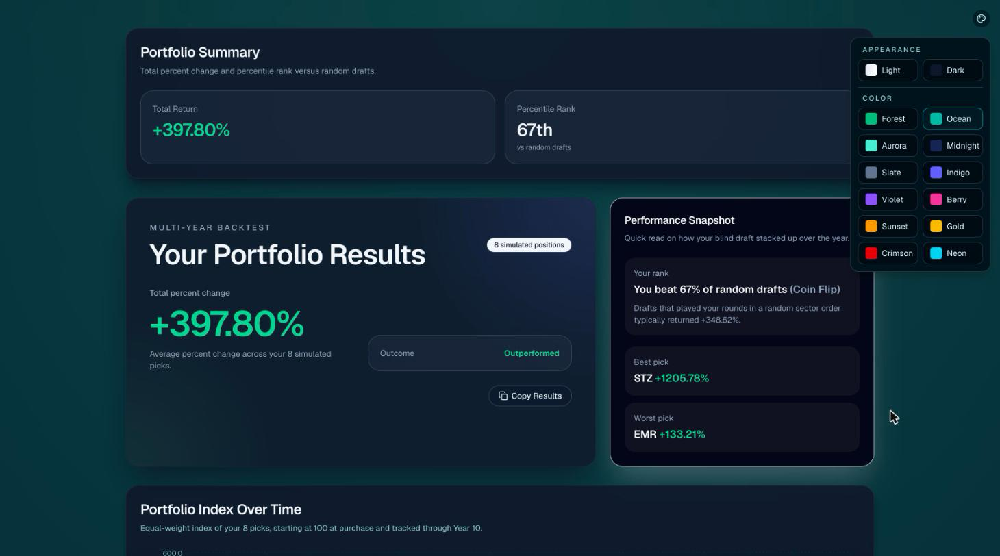

# Cline Stock Market Game

A blind stock-drafting game where you pick one stock per sector across 8 rounds, score each round against a randomly assigned real historical market year, and see a 10-year portfolio value chart and your rank among 2,000 simulated random drafts.

**[Try the live demo](https://stock-market-draft.vercel.app)**. Runs entirely in the browser with no sign-up.



<table>
  <tr>
    <td width="33%"></td>
    <td width="33%"></td>
    <td width="33%"></td>
  </tr>
</table>

Draft a stock portfolio, sector by sector, without seeing any price or
performance data — then find out how it would have actually done over a real
historical period.

Built as a project at [Cline](https://cline.bot).

## How it works

1. **Draft** — Pick one stock from each of 8 sectors, one sector at a time.
   You won't see price, performance, or fundamentals while picking — just the
   company name and sector.
2. **Simulate** — Once your portfolio is complete, see how it would have
   performed over a fixed historical period, using real historical price data.
3. **Results** — See how your total portfolio return played out.

## How to Play

1. Start the app (see Getting Started below) and open
   [http://localhost:3000](http://localhost:3000).
2. On the home page, pick a mode:
   - **Start the draft** (Blind) — you see only each stock's ticker and
     company name, nothing else.
   - **Start an informed draft** (Informed) — you also see each stock's price
     as of the start of 2022, but not how it performed from there. The
     outcome is still unknown either way.
3. You'll go through 8 rounds, covering all 8 sectors (Technology, Healthcare,
   Financials, Energy, Consumer Discretionary, Consumer Staples, Industrials,
   Utilities). In each round: click a stock to select it, then click
   "Confirm Draft Pick." Every pick counts equally, so there is nothing to
   allocate.
4. After your 8th pick, you're taken straight to the results page, showing
   your total return and a breakdown of how each individual pick performed.

## Tech Stack

- [Next.js](https://nextjs.org/) (App Router) + React + TypeScript
- [Tailwind CSS](https://tailwindcss.com/) + [shadcn/ui](https://ui.shadcn.com/)
- Historical price data via [Twelve Data](https://twelvedata.com/), fetched once
  and bundled as static data — no live API calls at runtime, no database

## Getting Started

```bash
npm install
npm run dev
```

Open [http://localhost:3000](http://localhost:3000) to view it.

## Historical Data Setup

Stock price data for 2022 is pre-fetched and committed to `data/historical/`. To regenerate or update this data:

### Prerequisites
Get a free Twelve Data API key at https://twelvedata.com

### Steps
1. Create a `.env.local` file in the root with:
TWELVE_DATA_API_KEY=your_api_key_here

2. Run:
```bash
   npm run fetch-historical
```
3. The script will prompt for your API key if `.env.local` doesn't exist
4. Historical price files will be saved to `data/historical/`

### Data Format
Each file (e.g., `data/historical/AAPL.json`) contains daily closing prices for 2022:
```json
[
  { "date": "2022-01-03", "close": 150.43 },
  { "date": "2022-01-04", "close": 149.63 }
]
```

## Project Status

Early development.

## License

TBD.
